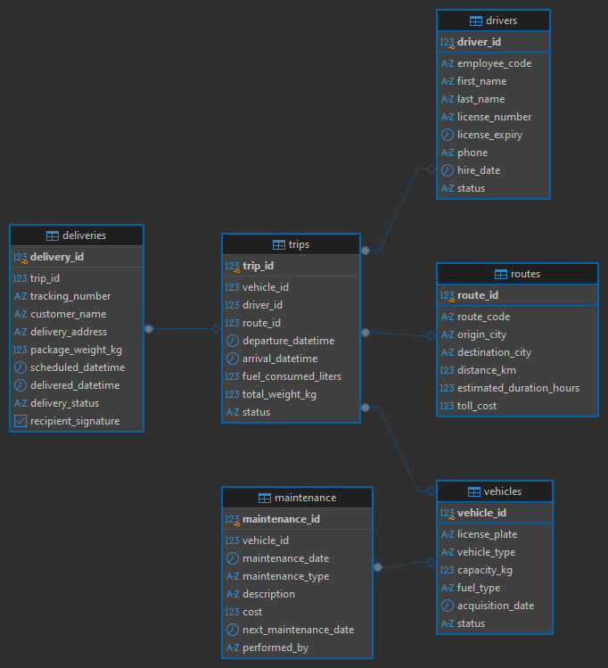

# FleetLogix — Proyecto Integrador Módulo 2

**Henry | Data Science | Luis Fernando Cornejo Martínez**

Proyecto académico de analítica logística: generación y análisis de datos operativos en PostgreSQL, optimización SQL, construcción de un Data Warehouse dimensional en Snowflake y propuesta de arquitectura AWS.

## Avances

| Etapa | Evidencia | Contenido |
|---|---|---|
| 1. Generación de datos | [Notebook](notebooks/Avance_1_DataGeneration.ipynb) | Modelo relacional, datos sintéticos, integridad y diagrama ER |
| 2. SQL y optimización | [Notebook](notebooks/Avance_2_SQLAnalysis.ipynb) | 12 consultas, índices y comparación de tiempos |
| 3. Data Warehouse | [Notebook](notebooks/Avance_3_DataWarehouse.ipynb) | Esquema estrella, ETL, SCD2 y cargas incrementales |
| 4. Cloud Architecture | [Notebook](notebooks/Avance_4_CloudArchitecture.ipynb) | Propuesta de servicios AWS; **no desplegada** |

## Diagramas

[Diagrama conceptual AWS](diagrams/aws_architecture_diagram.png)

## Estructura

- `notebooks/`: cuatro avances documentados y evidencias guardadas.
- `scripts/`: generación, consultas SQL, índices, modelo dimensional, ETL y prototipos AWS.
- `diagrams/`: modelo ER y arquitectura AWS.
- `docs/`: manual SQL, documentación técnica, diccionario de datos y análisis AWS.
- [`GUIA_EJECUCION.md`](GUIA_EJECUCION.md): dependencias, configuración, autenticación y limitaciones.

## Resultados documentados

El proyecto incluye generación de datos de seis entidades operativas, consultas analíticas, optimizaciones e implementación académica de ETL hacia Snowflake. Las salidas de notebooks corresponden a ejecuciones anteriores y no implican que los servicios sigan activos. La arquitectura AWS es **conceptual**; los recursos y API no fueron desplegados.

## Seguridad y reproducción

**No se incluyen contraseñas ni tokens PAT.** PostgreSQL y Snowflake requieren configuración y permisos propios; no se proporciona una copia completa de los datos operativos. Para reproducir las conexiones consulta [`GUIA_EJECUCION.md`](GUIA_EJECUCION.md) y `CONFIGURACION_EJEMPLO.env.txt`. Nunca publiques un `.env` real ni credenciales en GitHub.

## Nota para evaluación

Los notebooks contienen evidencias de ejecución; algunas celdas requieren infraestructura y credenciales privadas para ejecutarse nuevamente. El avance AWS es una propuesta académica y no representa servicios en producción.
